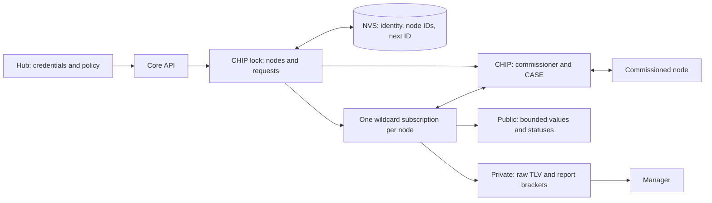

<!-- SPDX-FileCopyrightText: 2026 Espressif Systems (Shanghai) CO LTD -->
<!-- SPDX-License-Identifier: Apache-2.0 -->

# Local Fabric

Core owns the hub's Matter fabric, commissioner, commissioned nodes, requests,
and subscriptions. It does not decide which app user may control a device or
interpret a node as a consumer device; [Fabric Manager](data_model/README.md) does the
latter. The raw [C API](include/fabric_core.h) is for trusted integrations.

## Lifetime and request path

The hub creates one Core, attaches Manager while Core is stopped, then starts
subscriptions and accepts requests. Core's bounded node array (16 in the hub)
and its request lifecycle are serialized by the CHIP stack lock. Stop rejects
new work, detaches subscriptions and waits for accepted requests to finish;
Manager must detach before Core is deleted. Stop cannot run from a CHIP callback.
The ESP-Matter controller stack itself remains process-wide after Core stops.

Commissioning reserves and persists a fresh node ID, obtains Wi-Fi credentials
and an optional Thread dataset from hub callbacks, and asks CHIP to pair.
After success Core persists the node and starts its subscription. A failed
subscription does not undo pairing: connectivity and identity are separate.
Core stores neither supplied Wi-Fi credentials nor the Thread dataset in its
own NVS namespace; CHIP manages its fabric credentials separately.

`fabric_core_config_t.skip_paa_and_cd_checks` installs a verifier that omits
PAA lookup, attestation certificate-chain verification and CD processing.
It retains DAC/PAI format and VID/PID checks, device attestation signature and
nonce verification, and the SDK's CSR and configured revocation checks. The
hub defaults this flag to `false` and uses the SDK's default verifier with
the mainnet DCL trust store. Zero-initialized configurations also use the
default verifier. The policy is selected when the process-wide controller
is first initialized.

Raw read, write and invoke address a commissioned node, endpoint and numeric
Matter path. Core connects via CASE and reports completion by request ID and
callback. Only an `ESP_OK` return means submission was accepted; an ID may
already have been assigned on submission failure. Completion may occur during
submission, so callers must prepare their pending state first. Callbacks are
CHIP-context work: do not block, retain callback-scoped values or stop Core
from them. Removing a node unpairs it before updating the saved node set;
`force=true` can remove it locally despite remote unpair failure.

## Reports, choices and limits

One wildcard subscription per node avoids competing UI polls and duplicate
subscriptions. The initial, possibly multipart report is held until CHIP
confirms the subscription; later reports have begin/end boundaries. Public
listeners receive bounded decoded values and per-path status; the sole private
Manager listener receives callback-scoped TLV so decoding is not lossy. Public
text/JSON may be truncated at `FABRIC_CORE_TEXT_MAX`. A backoff or terminated
subscription retains the commissioned node; CHIP resubscribes or a caller may
request a retry. `active` indicates a completed initial snapshot, not a
promise of continued reachability.

Core relies on CHIP for Matter sessions, **not** for app-user authorization.
Its raw API checks node membership but does not authorize commissioning,
commands, writes, removal or reset. Callers must authenticate and authorize
those operations. The node table, public listener slots and decoded values are
bounded; a full table or failed connection returns an error. A corrupt NVS
identity fails startup rather than silently creating a replacement fabric.
Initial subscription setup failure fails `fabric_core_start`; later connectivity
failure leaves nodes registered. An upstream request that never completes can
hold up stop, which waits for in-flight callbacks.

Core NVS and CHIP's operational state are not one atomic store. A remotely
successful commission followed by local persistence failure can leave a
paired node outside Core's saved table. `fabric_core_factory_reset` erases only
Core's NVS namespace on a stopped Core; the platform reset must also handle
CHIP and Manager state. Commands do not populate a property cache: only reads
and subsequent reports establish observed values.
