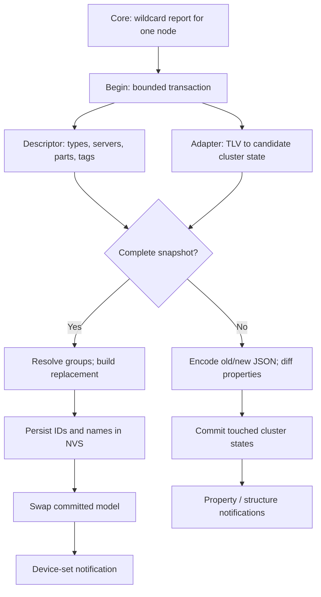
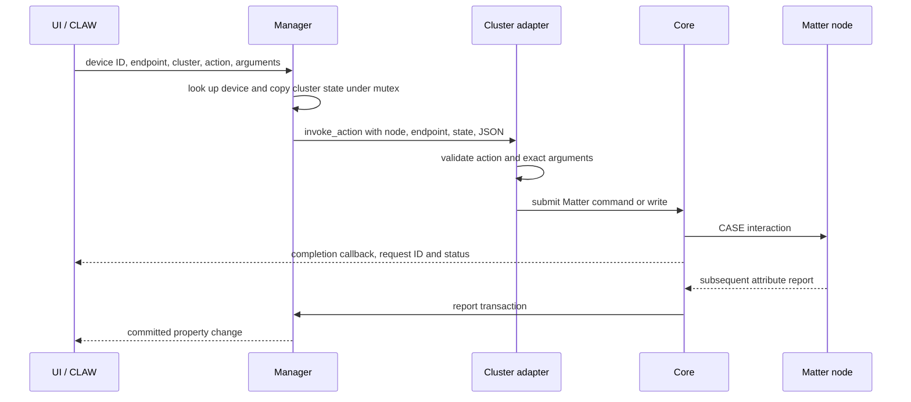

<!-- SPDX-FileCopyrightText: 2026 Espressif Systems (Shanghai) CO LTD -->
<!-- SPDX-License-Identifier: Apache-2.0 -->

# Local Fabric data model

The data model implements [Fabric Manager](../include/fabric_manager.h), turning
[Core](../README.md) reports into consumer devices. It owns
Matter topology resolution, stable device IDs, selected cluster state and
semantic actions. The web UI, on-device UI and CLAW use its
[JSON contract](SCHEMA.md); they do not reconstruct Matter topology.

## Identity and in-memory model

One Matter node may contain several devices. Manager decodes Descriptor
DeviceTypeList, ServerList, PartsList and TagList. Endpoint 0 is
administrative; an aggregator separates child devices, while a child's
non-aggregator descendants stay with it. Standalone roots form devices.
Ambiguous parents or cycles are omitted, not assigned to a guessed device.
Device type supplies a presentation category; an endpoint's ServerList
selects supported cluster adapters. TagList names endpoints, not devices.

The committed model is three flat arrays: devices contain endpoint ranges;
endpoints contain cluster ranges; clusters contain an adapter pointer and
fixed-size state. This avoids a pointer-heavy mutable graph at the hub's
bounded scale. A `device_id` is persisted against the private node/root pair,
so renaming or resubscribing preserves it. Moving a device to a new root can
assign a new ID; endpoint IDs stay visible to disambiguate repeated clusters.

## The cluster boundary

Each supported Matter cluster registers one private `cluster_adapter` with a
numeric `cluster_id` and a public string `key`. It has only three operations:

| Operation | Manager supplies | Adapter owns |
| --- | --- | --- |
| `decode_attribute` | TLV attribute, candidate state | Checked decode |
| `encode_json` | Committed state, output maps | Properties and actions |
| `invoke_action` | State, action, JSON args | Validate, submit to Core |

Adapters interpret their own fixed-size, trivially copyable `cluster_state`;
Manager never decodes their fields or guesses writable capabilities from a
cluster ID. A decoder ignores unrelated attributes; an encoder publishes
reported values (or `null`) and only applicable actions; an invoker checks the
action name, required/extra arguments, ranges and reported capabilities.
Unknown clusters remain absent. This small interface localizes Matter TLV and
command rules without teaching every consumer those rules or exposing raw
arbitrary commands. See [SCHEMA.md](SCHEMA.md) for the supported keys.

## Report path

Core holds the initial, possibly multipart report until subscription setup
completes. Manager keeps one bounded transaction per reporting node, keyed by
node ID, with endpoint/relationship tables and selected adapter states.
A full snapshot resolves topology, preserves other nodes and saves new device
metadata **before** swapping the model. Incremental reports decode against
committed state, prepare old/new property values and commit touched states
together; they do not persist readings. Structural changes signal consumers
to refetch list/detail JSON. Neither path fabricates state from a command.

Invalid Descriptor data or endpoint/field/relationship overflow drops the
transaction; extra tags are ignored. An invalid individual cluster attribute
is skipped, retaining prior state. A valid but misleading topology can omit
devices from a replacement snapshot. Failed allocation or NVS save prevents
a snapshot commit; property notifications can also be lost on allocation
failure, so they are not a durable event log.

## Control path

The model mutex is released before the adapter submits to Core. Action
completion reports protocol outcome, **not** confirmed property state; the
next subscription report is authoritative. An offline node, stale action or
remote refusal can still fail. `fabric_manager_remove_device` resolves the hidden
node ID, then delegates whole-node removal to Core; it cannot remove only one
device exposed by a multi-device node.

## Trust, persistence and failure boundaries

A paired device controls its claimed topology, labels and readings. Bounds,
Descriptor checks and adapter decoders prevent many malformed or oversized
reports from being published, but valid-looking lies remain untrusted.
Manager checks addressed device/endpoint/cluster and exact action arguments;
**authentication and authorization belong to callers**, not Manager. Raw Core
access bypasses the semantic action boundary.

NVS saves device IDs, hidden node/root mappings, names and rooms, **not**
endpoint membership or readings. After restart, stored devices may be offline
and lack detail until a fresh snapshot. Invalid store version/shape resets
Manager IDs and presentation names; Core and Manager stores are separate, so
platform reset must address both. Memory and transaction limits are set by
`Kconfig` (default 16 devices, 32 endpoints, 16 clusters per endpoint).

Manager attaches before Core starts and detaches after it stops. The state mutex
protects JSON reads and renames against report commits. Listeners are bounded
and dispatched synchronously after unlocking state: report notifications run
on the CHIP task, while a rename notifies on its calling task. Callbacks must
be short, copy callback-scoped values and avoid listener registration changes
from inside a callback. Callers release list/detail JSON with
`fabric_manager_free_json()`; [the public API](../include/fabric_manager.h) describes the
callable contract.
